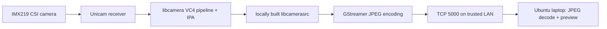

# Raspberry Pi 4 IMX219 Camera Fix on Ubuntu 24.04 (libcamera 0.2.0)

**Reproducible engineering case study and local-build toolkit** for an IMX219 CSI camera detected by `libcamera` but crashing during frame capture on Ubuntu 24.04 (Noble) for Raspberry Pi 4.

> **Status:** One Raspberry Pi 4 Model B Rev 1.5 / 2 GiB / Ubuntu 24.04.5 LTS installation was tested on **9 October 2026**. A 5-frame capture completed successfully after applying an existing upstream libcamera patch; a JPEG was transferred to a laptop, and local-network live streaming was reported working. This is a **single-device validation**, not a production certification.

## The failure

`cam -l` lists `imx219`, but the packaged `cam -c 1 --capture` aborts:

```text
FATAL default ipa_base.cpp:396 assertion "it != buffers_.end()" failed in prepareIsp()
Aborted (core dumped)
```

The installed Ubuntu package was `libcamera0.2 0.2.0-3fakesync1build6` (arm64). In the Raspberry Pi VC4 pipeline, `params.buffers.embedded` was not initialized when no embedded buffer ID was set. The accepted upstream one-line patch initializes it to zero before the optional embedded-buffer branch.

```diff
 params.delayContext = bayerFrame.delayContext;
+params.buffers.embedded = 0;

 if (embeddedBuffer) {
```

**Attribution:** This is **not a newly invented fix**. It reproduces the patch by **Elias Naur**, accepted upstream as [libcamera patch 19446](https://patchwork.libcamera.org/patch/19446/), commit [`0dc737d3e31112973c9286eb7775b8f730352a75`](https://patchwork.libcamera.org/patch/19446/). The original patch describes essentially the same `prepareIsp()` assertion in v0.2.0.

## Architecture



## What this repository provides

```text
rpi4-ubuntu24-imx219-libcamera-fix/
├── README.md
├── docs/
│   ├── CASE_STUDY.md          # Symptoms → investigation → root cause → evidence
│   ├── REPRODUCE.md           # Clean Ubuntu 24.04 build walkthrough
│   ├── VALIDATION.md          # What was observed and what remains untested
│   ├── STREAMING.md           # Raspberry Pi → trusted LAN → laptop
│   ├── TROUBLESHOOTING.md
│   └── PUBLISHING.md
├── patches/
│   └── 0001-vc4-initialize-embedded-buffer.patch
├── scripts/
│   ├── build-patched-libcamera.sh
│   ├── test-capture.sh
│   ├── capture-jpeg.sh
│   ├── stream-pi.sh
│   └── view-laptop.sh
├── QUICK_START_TAMIL.md
└── .gitignore
```

## Quick start (Raspberry Pi)

1. **Read [REPRODUCE.md](docs/REPRODUCE.md)** and enable Ubuntu `noble-updates` and `deb-src` if needed. Back up APT sources first. Install the documented build and GStreamer dependencies.
2. Obtain the **Ubuntu Noble libcamera 0.2.0 source**:

   ```bash
   mkdir -p "$HOME/camera-fix" && cd "$HOME/camera-fix"
   apt source libcamera
   # expect an extracted libcamera-0.2.0 directory
   ```

3. Place this repository alongside the source (or clone/extract it anywhere). Build:

   ```bash
   bash /path/to/this-repo/scripts/build-patched-libcamera.sh \
     "$HOME/camera-fix/libcamera-0.2.0"
   ```

4. Test capture, still **without installing into the operating system**:

   ```bash
   bash /path/to/this-repo/scripts/test-capture.sh \
     "$HOME/camera-fix/libcamera-0.2.0"
   ```

5. Optionally create a JPEG from an 800 × 600 XRGB8888 raw frame:

   ```bash
   bash /path/to/this-repo/scripts/capture-jpeg.sh \
     "$HOME/camera-fix/libcamera-0.2.0"
   ```

6. On the Raspberry Pi, start MJPEG-over-TCP video to your **trusted local network**:

   ```bash
   bash /path/to/this-repo/scripts/stream-pi.sh \
     "$HOME/camera-fix/libcamera-0.2.0"
   ```

7. On the Ubuntu laptop (on the same local network), run:

   ```bash
   bash /path/to/this-repo/scripts/view-laptop.sh Hanan.local
   # or: bash scripts/view-laptop.sh <RPI_CURRENT_LAN_IP>
   ```

The Pi process stays running while video is being viewed. Stop it using **Ctrl+C**. `Hanan.local` is only an example hostname from the test device; replace it with the hostname/IP of your own Raspberry Pi.

## Boundaries and safety

- **Do not run** `sudo ninja install` or globally replace the distro `libcamera0.2` package as part of this guide. The build is deliberately launched through `meson devenv`.
- Build output includes GCC `-Wmaybe-uninitialized` warnings in generated `ProcessParams` deserialization. The reproduction sets `-Dwerror=false` to compile for evaluation; it **does not prove those warnings harmless or fix their underlying cause**.
- The demo TCP MJPEG stream **has no authentication or transport encryption** and the original manual test used `0.0.0.0`. The supplied streaming script defaults to the **current `wlan0` IPv4** to reduce accidental exposure; override with `STREAM_BIND_IP` only when needed. Use it only on a trusted network and/or limit it with network firewall rules. It is **not suitable for public internet exposure**.
- Local SSH over a phone hotspot is separate from network-video transport. SSH/Tailscale configuration is **not modified** by these scripts.
- Results apply to this Ubuntu/libcamera combination, not every Raspberry Pi camera, OS or library version.

## Documentation and sources

- [Case study](docs/CASE_STUDY.md) — what failed, why, and how it was debugged.
- [Reproduction](docs/REPRODUCE.md) — build prerequisites, patching, rollback.
- [Validation](docs/VALIDATION.md) — before/after transcript highlights.
- [Streaming](docs/STREAMING.md) — sender and receiver GStreamer pipelines.
- [Troubleshooting](docs/TROUBLESHOOTING.md) — common issues from this setup.
- [Accepted upstream patch](https://patchwork.libcamera.org/patch/19446/)
- [libcamera official build guide](https://libcamera.org/getting-started.html)

## Publishing this as a GitHub project

Read [PUBLISHING.md](docs/PUBLISHING.md) for repository creation commands and a pre-publication safety checklist. **Helper scripts were syntax-checked but have not yet been run end-to-end on a second device**; validate them in your own environment before marking the project fully reproducible.

## Licensing and credit

`libcamera` is third-party open-source software with its own licensing terms; it is **not vendored** here. The patch is reproduced to demonstrate and apply **Elias Naur's accepted upstream change**. Original documentation and helper scripts in this project are offered under MIT terms (see `LICENSE`).
